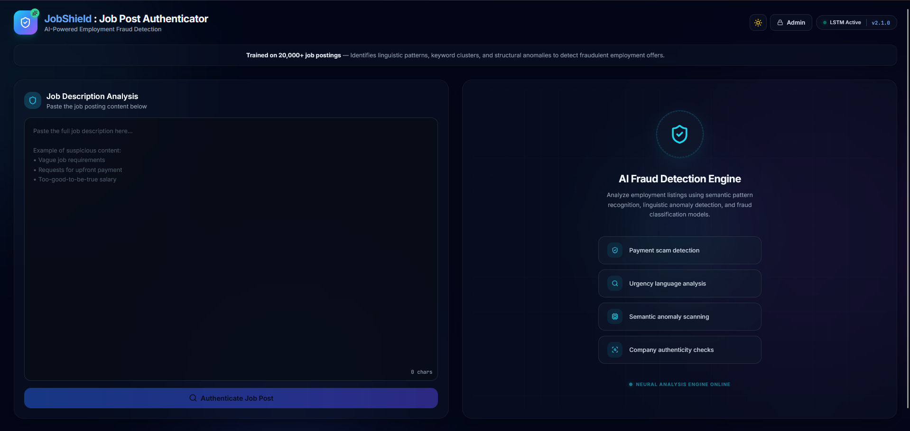
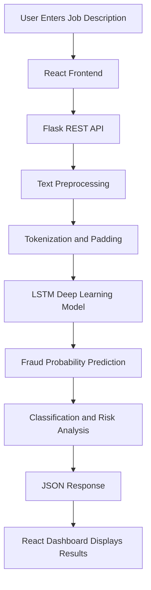

# 🛡️ JobShield – AI-Powered Fake Job Detection System

**An LSTM-based Deep Learning System to Detect Fraudulent Job Postings Using NLP**

JobShield is an AI-powered fake job detection system that helps job seekers identify potentially fraudulent job postings. It uses Natural Language Processing (NLP) and a Long Short-Term Memory (LSTM) neural network to analyze job descriptions and classify them as **Legitimate** or **Fraudulent**.

The system provides real-time predictions through a React-based web interface, displaying fraud probability, confidence scores, risk indicators, and warning messages.

---

## ✨ Features

- **AI-Powered Fraud Detection:** Uses an LSTM deep learning model to identify suspicious job postings.
- **Natural Language Processing:** Cleans, tokenizes, and transforms job descriptions into numerical sequences.
- **Real-Time Predictions:** Analyzes submitted job descriptions through a Flask REST API.
- **Fraud Probability Score:** Displays the probability of a job posting being fraudulent.
- **Interactive Risk Meter:** Visual representation of the predicted risk level.
- **Warning Indicators:** Highlights potentially suspicious characteristics in job descriptions.
- **Admin Dashboard:** Provides access to prediction statistics and activity logs.
- **Data Visualization:** Displays model performance and analytical insights.
- **Responsive Interface:** Built with React and Tailwind CSS.

---

## 🖥️ Screenshots


The application includes the following interfaces:

| Interface | Description |
|---|---|
| Main Dashboard | Input job descriptions for analysis |
| Prediction Results | Displays classification, confidence, and risk score |
| Risk Analysis | Visualizes suspicious indicators |
| Admin Dashboard | Displays prediction statistics and activity logs |
| Model Evaluation | Displays model accuracy and confusion matrix |

*Add your actual application screenshots to a `screenshots/` directory and link them here.*

<!-- Example:


-->

---

## ⚙️ Technology Stack

### Frontend
- React.js
- JavaScript
- Tailwind CSS
- Vite

### Backend
- Python
- Flask
- REST API

### Machine Learning & NLP
- TensorFlow
- Keras
- LSTM (Long Short-Term Memory)
- NumPy
- Pickle
- TensorFlow Lite

### Database
- SQLite

### Development Tools
- Visual Studio Code
- Postman
- Git & GitHub

---

## 🧠 How It Works

JobShield follows a machine learning pipeline to identify fraudulent job postings.



### 1. Data Collection
A dataset containing approximately 18,000 job postings, including legitimate and fraudulent listings, was collected for model development.

### 2. Data Preprocessing
The textual data is cleaned and prepared using NLP techniques:

- Lowercase conversion
- HTML tag removal
- Special character and URL removal
- Stopword removal
- Tokenization
- Sequence padding

### 3. Model Training
An LSTM-based neural network is trained to understand contextual and sequential patterns in job descriptions.

The model architecture includes:
- Embedding Layer
- LSTM Layer
- Dropout Layer
- Dense Layer
- Sigmoid Output Layer

SMOTE is also used to address class imbalance during model development.

### 4. Prediction
The trained model analyzes the processed job description and generates a fraud probability score.

### 5. Result Visualization
The frontend receives the prediction through the Flask API and displays the classification, risk meter, confidence score, and warning indicators.

---

## 📊 Model Evaluation

The LSTM model is evaluated using standard classification metrics:

| Metric | Purpose |
|---|---|
| Accuracy | Measures overall prediction correctness |
| Precision | Measures correctness of fraudulent predictions |
| Recall | Measures how many fraudulent postings are detected |
| F1-Score | Balances precision and recall |
| Confusion Matrix | Shows correct and incorrect classifications |
| ROC-AUC | Evaluates classification performance across thresholds |

The project report includes a classification result of approximately **98% accuracy** in its confusion matrix analysis.

---

## 🔌 API Documentation

### Predict Job Authenticity

**Endpoint:** `POST /predict`

**Base URL (Local):**
```text
http://127.0.0.1:5000
```

**Request Headers:**
```http
Content-Type: application/json
```

**Request Body:**
```json
{
  "combined_text": "Earn money quickly. No experience required. Pay registration fee."
}
```

**Example Response:**
```json
{
  "result": "Fraudulent",
  "score": 0.97,
  "status": "success"
}
```

The response contains:
- `result`: Predicted job classification.
- `score`: Fraud probability score.
- `status`: API response status.

---

## 🚀 Getting Started

Follow these general steps to set up the project locally. Adjust directory paths according to the actual repository structure.

### Prerequisites

Make sure you have installed:

- Python
- Node.js and npm
- Git

### 1. Clone the Repository

```bash
git clone https://github.com/YOUR_USERNAME/JobShield.git
```

```bash
cd JobShield
```

### 2. Backend Setup

Navigate to your Flask backend directory:

```bash
cd backend
```

Create a virtual environment:

```bash
python -m venv venv
```

Activate it:

**Windows:**
```bash
venv\Scripts\activate
```

**Linux/macOS:**
```bash
source venv/bin/activate
```

Install dependencies:

```bash
pip install -r requirements.txt
```

Start the Flask server using the project's backend entry point:

```bash
python app.py
```

The backend should be available at:

```text
http://127.0.0.1:5000
```

### 3. Frontend Setup

Open another terminal and navigate to the React frontend directory:

```bash
cd frontend
```

Install dependencies:

```bash
npm install
```

Start the development server:

```bash
npm run dev
```

Open the local URL displayed by Vite in your browser.

---

## 📁 Project Architecture

The application follows a modular architecture with separate frontend, backend, and machine learning components.

```text
JobShield/
│
├── frontend/
│   ├── src/
│   ├── public/
│   └── package.json
│
├── backend/
│   ├── app.py
│   ├── models/
│   ├── tokenizer/
│   ├── database/
│   └── requirements.txt
│
├── screenshots/
│
└── README.md
```

*Note: This is a suggested organizational layout. Replace it with the actual repository structure before publishing.*

---

## 🔮 Future Enhancements

Potential improvements include:

- Browser extension for automatically analyzing job postings.
- Mobile application using TensorFlow Lite.
- Multi-language job description analysis.
- Integration with existing job portals.
- Real-time job scraping and analysis.
- Advanced NLP models such as BERT and Transformers.
- Cloud deployment for improved scalability.
- Continuous model improvement using collected feedback.

---

## 🎯 Project Objective

The primary objective of JobShield is to improve online recruitment safety by using Artificial Intelligence and Deep Learning to identify fraudulent job opportunities.

By combining NLP, LSTM-based classification, and a modern web interface, JobShield aims to help job seekers make safer and more informed decisions.

---

## 👨‍💻 Contributors

This project was developed as part of the Master of Computer Applications (MCA) program at **Kamla Nehru Institute of Technology (KNIT), Sultanpur**.

- **Abhinav Vishwakarma**

---

## 📄 License

Choose and add an appropriate open-source license before distributing this project.

---

⭐ If you find this project interesting, consider giving the repository a star!
